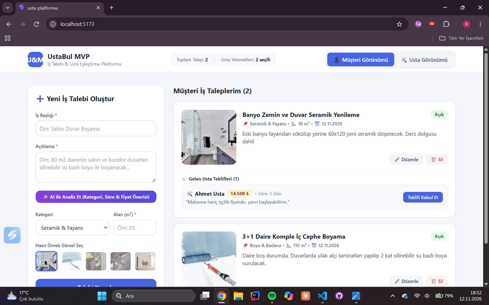

# 🛠️ UstaBul MVP - İş Talebi ve Usta Eşleştirme Platformu

Bu proje, Web Geliştirme JavaScript Proje Yönergesi kapsamında **React (Vite)** ve **Tailwind CSS** kullanılarak geliştirilmiş çift taraflı (Müşteri & Usta) bir iş talebi, yetenek eşleştirme ve fiyat teklifi yönetim uygulamasıdır.

## 📸 Proje Ekran Görüntüsü

(./public/ekran-goruntusu2.png)

## 🚀 Özellikler ve Karşılanan Gereksinimler

* **Modern JS Kütüphanesi & Stil:** ReactJS (Vite) ve Tailwind CSS kullanılmıştır.
* **Klasör Mimarisi:** `src/Components`, `src/Pages` ve `src/Interfaces` klasör yapısına sahiptir.
* **Veri Saklama:** Tüm iş talepleri, teklifler ve usta yetenekleri `LocalStorage` üzerinde kalıcı olarak tutulur.
* **CRUD İşlemleri:**
  * **Ekle (Create):** Müşteri yeni iş talebi oluşturur; usta eşleşen taleplere fiyat teklifi verir.
  * **Listele (Read):** Müşteri taleplerini ve gelen teklifleri görür; usta yalnızca kendi yetenekleriyle kesişen talepleri görür.
  * **Güncelle (Update):** Müşteri talebini düzenler veya gelen teklifi kabul eder; usta teklifini düzenler ve yeteneklerini günceller.
  * **Sil (Delete):** Müşteri iş talebini siler; usta verdiği teklifi geri çeker.
* **✨ Akıllı AI Öneri Modülü:** Müşteri iş açıklamasını yazdığında anahtar kelime ve metrekare analizine göre otomatik kategori, tahmini süre, fiyat aralığı ve gerekli usta yeteneği önerilir.